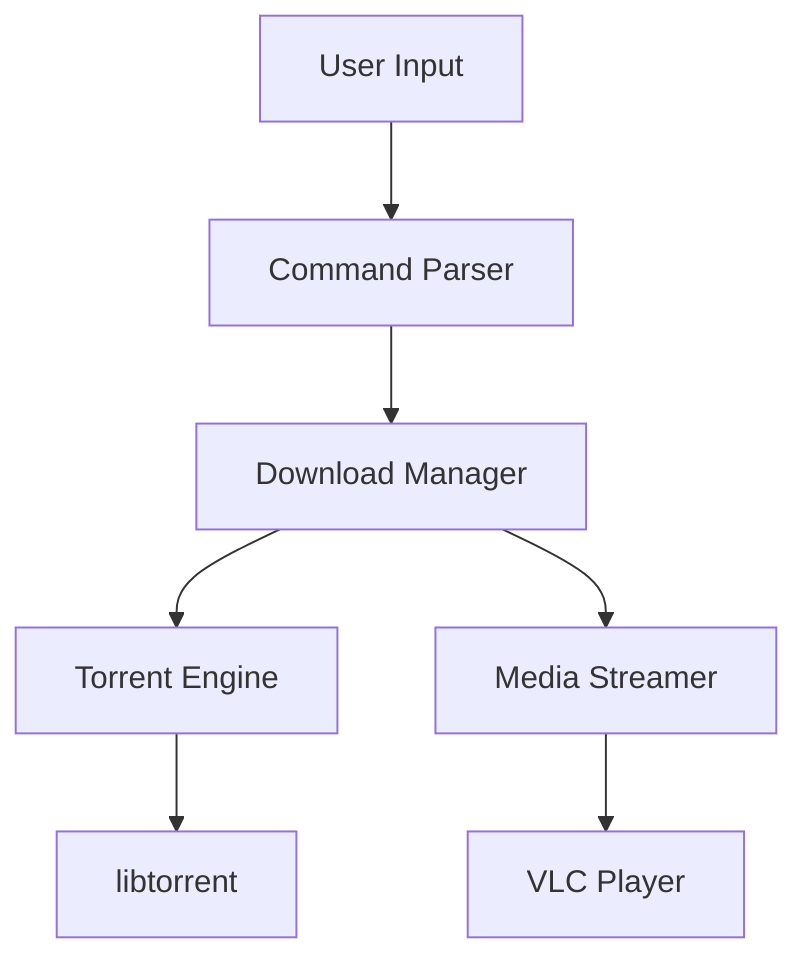

# Architecture Documentation

This directory contains high-level system architecture documentation for torrent-dl.

## Purpose

Architecture documentation provides:
- Visual representation of system components
- Understanding of how components interact
- Guidance for AI agents making changes

## Contents

- `system-overview.md` - High-level system architecture
- Component diagrams (Mermaid.js format)
- Integration documentation

## Diagram Standards

All architecture diagrams use **Mermaid.js** for version control and easy updates.

### Example Mermaid Diagram

## For AI Agents

When making architectural changes:

1. **Read** existing architecture docs first
2. **Update** diagrams to reflect your changes
3. **Add** new diagrams for new components
4. **Document** integration points

### Best Practices for Diagrams

- Keep diagrams simple and focused
- Use meaningful labels (module names, not generic terms)
- Group related components using subgraphs
- Show data flow direction explicitly
- Update diagrams as code evolves

## Tools

- **Preview**: Use [mermaid.live](https://mermaid.live/) for editing
- **GitHub**: Mermaid renders natively in GitHub markdown
- **CI**: Consider automated diagram validation in CI

## Related Documents

- See `docs/specs/` for detailed component specifications
- See `docs/adrs/` for architectural decisions
