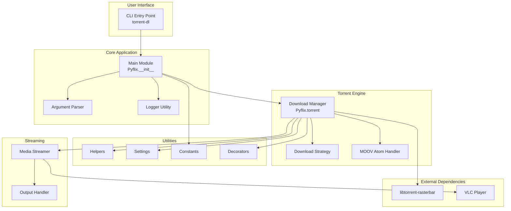
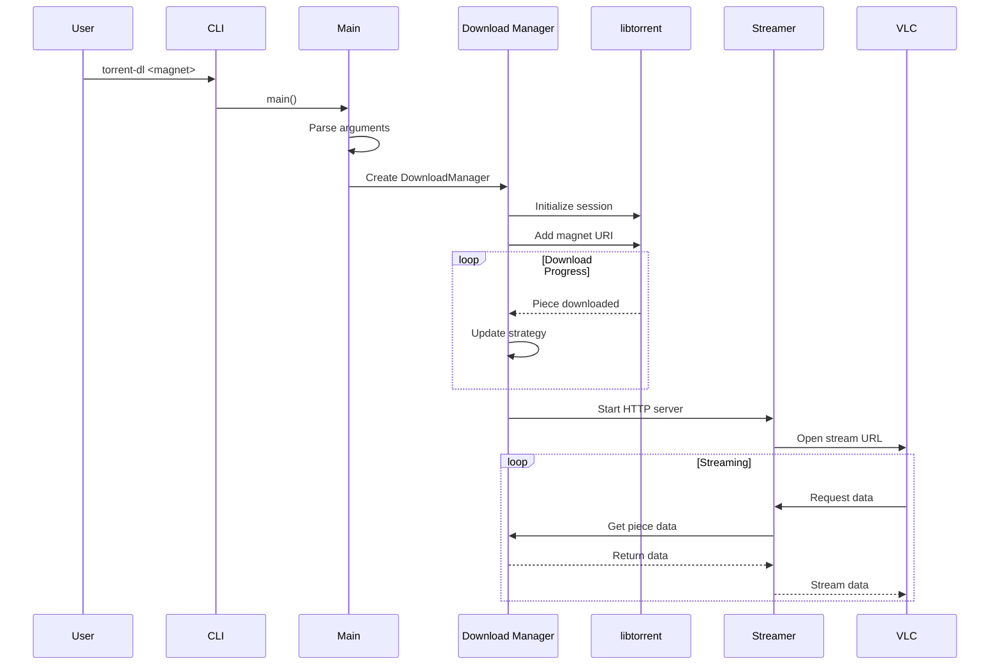

# torrent-dl System Architecture

## Overview

torrent-dl is a Python application for watching and downloading torrents simultaneously. It combines torrent downloading capabilities with media streaming functionality.

## High-Level Architecture

## Component Descriptions

### User Interface Layer

| Component | File | Purpose |
|-----------|------|---------|
| CLI Entry Point | `torrent-dl` | Command-line executable |

### Core Application Layer

| Component | File | Purpose |
|-----------|------|---------|
| Main Module | `Pyflix/__init__.py` | Application entry, argument parsing |
| Logger | `Pyflix/utils/logger.py` | Logging configuration |

### Torrent Engine Layer

| Component | File | Purpose |
|-----------|------|---------|
| Download Manager | `Pyflix/torrent/__init__.py` | Orchestrates torrent downloads |
| Strategy | `Pyflix/torrent/strategy.py` | Download prioritization logic |
| MOOV Handler | `Pyflix/torrent/moov.py` | MP4 atom manipulation for streaming |

### Utilities Layer

| Component | File | Purpose |
|-----------|------|---------|
| Helpers | `Pyflix/utils/helpers.py` | General utility functions |
| Settings | `Pyflix/utils/settings.py` | Configuration management |
| Constants | `Pyflix/utils/constants.py` | Application constants |
| Decorators | `Pyflix/utils/decorators.py` | Function decorators |

### Streaming Layer

| Component | File | Purpose |
|-----------|------|---------|
| Streamer | `Pyflix/utils/streamer.py` | HTTP streaming server |
| Output | `Pyflix/utils/output.py` | Console output formatting |

## Data Flow

## External Dependencies

### libtorrent-rasterbar

- **Purpose**: BitTorrent protocol implementation
- **Integration**: Python bindings via `python-libtorrent`
- **Key Features**: Piece prioritization, sequential download

### VLC Player

- **Purpose**: Media playback
- **Integration**: Launched as subprocess
- **Features**: Streaming playback from HTTP server

## Configuration

Configuration is managed through:
- Command-line arguments (primary)
- `settings.yaml` (defaults)
- Environment variables (optional)

## Future Considerations

- Plugin architecture for additional players
- Web-based UI alternative
- Multiple simultaneous downloads
- Download queue management
